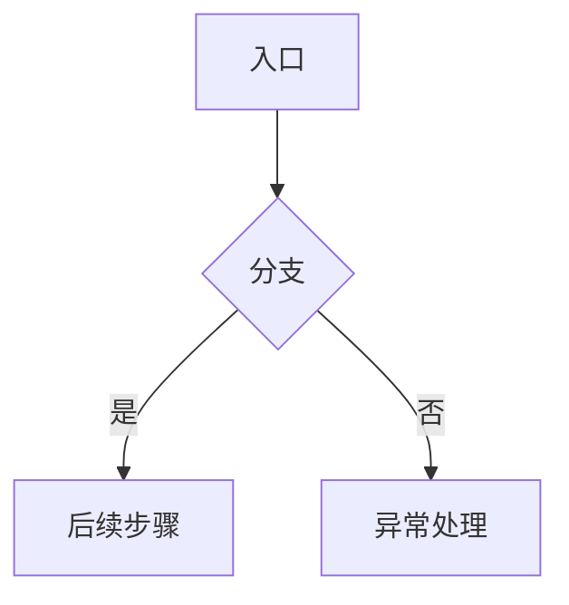
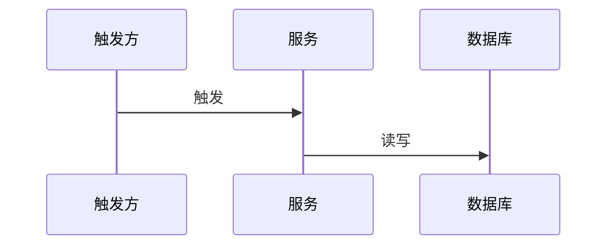
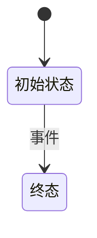
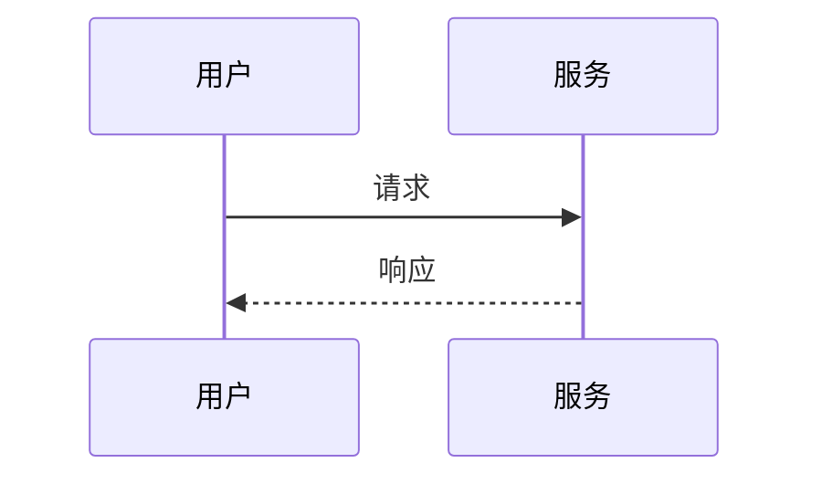
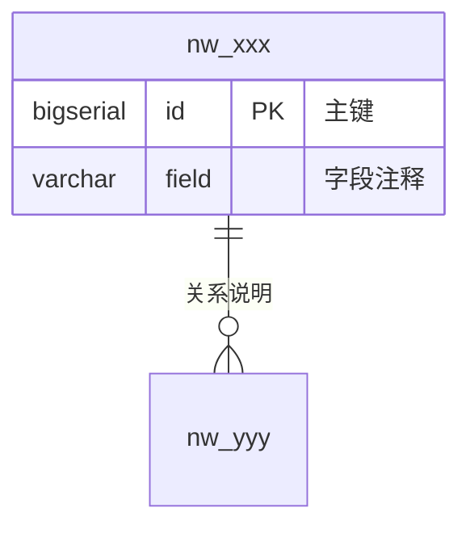

# {功能名称} — 详细设计文档

> 复制本模板至 `开发计划/{功能名称}-详细设计.md`，删除占位说明后填充。

---

## 1. 需求描述

### 1.1 背景与目标

- **业务背景：** {当前痛点、涉及平台/角色、耗时或成本}
- **设计目标：**
  1. {目标 1，尽量可量化}
  2. {目标 2}
- **非目标（Out of Scope）：**
  - {本期不做的事项 1}
  - {本期不做的事项 2}

### 1.2 关联需求

| 需求 ID | 功能 | 优先级 | 说明 |
| --- | --- | --- | --- |
| FR-001 | {功能简述} | P0/P1 | {依赖或备注} |

### 1.3 用户角色与权限

| 角色 | 权限范围 | 本功能可执行操作 |
| --- | --- | --- |
| {角色名} | {权限} | {可执行操作} |

### 1.4 核心场景

| 场景 ID | 角色 | 前置条件 | 操作步骤 | 预期结果 |
| --- | --- | --- | --- | --- |
| US-001 | {角色} | {前置} | {步骤} | {结果} |

### 1.5 约束与假设

| 类型 | 内容 |
| --- | --- |
| **业务约束** | {业务规则、数量限制等} |
| **技术约束** | PostgreSQL；`schema.sql` 仅末尾追加；异常用 `BizException(ErrorCode.xxx)` |
| **依赖假设** | {外部系统、已有功能假设} |

### 1.6 验收标准（摘自 PRD）

- **[FR-xxx] {标题}:** Given {前置}, When {操作}, Then {结果}。

### 1.7 PRD 与 UX 差异

| 项 | PRD | UX 原型 | 设计决策 |
| --- | --- | --- | --- |
| {差异项} | {PRD 描述} | {UX 描述} | **跟 PRD / 跟 UX / 详细设计定为 …** |

> **{规范名称}：** {对关键 UX/文案/交互的明确约定，避免实现时分歧}

---

## 2. 流程图

### 2.1 {用户主流程名称}



### 2.2 {后台/定时任务名称}



### 2.3 {核心实体}状态



### 2.4 异常与分支

| 分支 | 触发条件 | 处理 | 用户提示 |
| --- | --- | --- | --- |
| {分支名} | {条件} | {后端/系统处理} | {前端文案} |

### 2.5 {可选：关键子流程}



---

## 3. 功能拆分

### 3.1 模块总览

```text
{功能名}/
├── 前端 ai-video-web
│   ├── views/{path}/           # 页面
│   ├── @api/{name}Api.ts
│   └── @types/{name}.ts
└── 后端 ai-video
    ├── controller/
    ├── service/
    ├── task/                   # 定时/异步任务（如有）
    ├── mapper/ + pojo/
    └── client/                 # 第三方客户端（如有）
```

### 3.2 功能模块清单

| 模块 ID | 模块名称 | 职责 | 前端 | 后端 | 优先级 |
| --- | --- | --- | --- | --- | --- |
| M-001 | {名称} | {一句话职责} | ✅/— | ✅/— | P0/P1 |

### 3.3 模块说明

#### M-001 {模块名称}

| 项 | 内容 |
| --- | --- |
| **职责** | {详细说明} |
| **复用** | {现有类/方法，如有} |
| **集成点** | {跳转、消息、其他模块，如有} |

<!-- 核心模块复制上方表格继续展开 -->

### 3.4 任务排期建议

| 任务 ID | 描述 | 预估 | 依赖 |
| --- | --- | --- | --- |
| T-001 | {任务} | {人天} | — |

---

## 4. 数据库设计

> **约定：** 逻辑关联不建物理外键；默认值由代码控制；变更仅追加至 `ai-video/schema.sql` 末尾。

### 4.1 ER 关系

> 实体名使用**物理表名**；Mermaid 字段第四列为字段注释。



**表名中文对照：**

| 物理表名 | 中文表名 | 说明 |
| --- | --- | --- |
| nw_xxx | {中文名} | {用途} |

**表关系说明：**

| 关系 | 基数 | 说明 |
| --- | --- | --- |
| A → B | 1 : N | {说明} |

**ER 图字段明细（含字段注释）：**

##### `nw_xxx` — {中文表名}

| 字段 | 类型 | 字段含义 | 字段注释 |
| --- | --- | --- | --- |
| id | BIGSERIAL | 主键 | 主键，自增 |

### 4.2 表结构

> **字段含义**为业务中文名；**业务说明**描述用途、取值约束与关联关系。

#### 4.2.1 `nw_xxx` — {中文表名}

{一句话表用途}

| 字段 | 字段含义 | 类型 | 必填 | 业务说明 |
| --- | --- | --- | --- | --- |
| id | 主键 | BIGSERIAL | 是 | 系统内部自增主键 |

**索引说明：**

| 索引名 | 字段 | 类型 | 用途 |
| --- | --- | --- | --- |
| uk_xxx | field | UNIQUE | {用途} |

<!-- 每张新表复制 4.2.x 小节 -->

### 4.3 枚举与状态码

#### {枚举名}（{字段名}）

| 存储值 | 中文含义 | 前端展示/行为 |
| --- | --- | --- |
| 0 | {含义} | {展示或是否可见} |

### 4.4 数据变更策略

| 场景 | 策略 |
| --- | --- |
| {场景} | {增删改策略} |

### 4.5 schema.sql 追加块（草稿）

> 追加至 `ai-video/schema.sql` 末尾；每张表及字段需 `COMMENT ON` 汉字说明，与 4.2 一致。

```sql
-- ============================================================================
-- YYYY-MM-DD {功能简述}：{表清单}
-- 幂等策略：CREATE TABLE IF NOT EXISTS
-- ============================================================================

-- {表中文说明}
CREATE TABLE IF NOT EXISTS nw_xxx (...);

COMMENT ON TABLE nw_xxx IS '{表注释}';
COMMENT ON COLUMN nw_xxx.field IS '{字段注释}';
```

---

## 5. 接口设计

> **规范：** 响应 `Result<T>`；业务异常 `BizException(ErrorCode.xxx)`；文档 `:8082/doc.html`。

### 5.1 接口总览

| 接口 ID | 方法 | 路径 | 说明 | 权限 |
| --- | --- | --- | --- | --- |
| API-001 | GET/POST | `/{path}` | {说明} | 登录/公开 |

### 5.2 接口明细

#### API-001 {接口名称}

**请求**

```http
GET /{path}?param=value
```

**Query / Body 参数**

| 参数 | 类型 | 必填 | 说明 |
| --- | --- | --- | --- |
| param | String | 是 | {说明} |

**响应 data**

```json
{
  "field": "value"
}
```

| 字段 | 类型 | 说明 |
| --- | --- | --- |
| field | String | {说明} |

**错误码**

| ErrorCode | 场景 |
| --- | --- |
| SERVICE_PARAM_ERROR | {场景} |

**后端逻辑**（复杂接口填写）

1. {步骤 1}
2. {步骤 2}

---

<!-- 每个 API 复制上方结构 -->

### 5.3 前后端类型映射

| 后端 VO | 前端类型 | 文件 |
| --- | --- | --- |
| `XxxVO` | `XxxType` | `ai-video-web/src/@types/xxx.ts` |

### 5.4 内部接口（非 REST）

| 组件 | 说明 |
| --- | --- |
| `{Class}#{method}` | {第三方调用、定时任务、队列消费者等} |

---

## 6. 附录

### A. 术语表

| 术语 | 说明 |
| --- | --- |
| {术语} | {定义；注明 PRD/UX 用语差异} |

### B. 风险与待决事项

| 编号 | 问题 | 影响 | 状态 |
| --- | --- | --- | --- |
| OQ-001 | {待决问题} | 高/中/低 | 待决 / 已决：{结论} |
| R-001 | {风险} | 高/中/低 | {缓解措施} |
